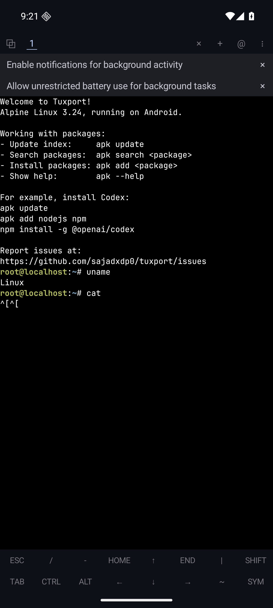

# Tuxport

Run Linux on Android.

Tuxport is a high-performance Linux terminal for Android phones and tablets.
Install packages, edit code and build projects on the device — without rooting
it. Alpine Linux comes bundled with the app, and Debian is one Settings screen
away.



**[Download from GitHub Releases](https://github.com/sajadxdp0/tuxport/releases)** ·
**[Source](https://github.com/sajadxdp0/tuxport)** ·
**[Website](https://sajadxdp0.github.io/tuxport/)**

Requires Android 11 or later on a 64-bit ARM device.

## What you get

- A complete Linux command line on an unrooted phone: bundled Alpine Linux
  with the apk package manager, or Debian from **Settings → Distribution**.
- Multiple terminal tabs with the extra keys row, find in scrollback,
  rectangle and line selection, and safe-paste confirmation.
- Codex CLI, Vim, Python, Node.js, Go, Rust and other ARM64 tools run as they
  are: Tuxport executes unmodified Linux binaries.
- Background sessions with notifications, listening-port reports, a privacy
  lock, and a diagnostic log exporter for troubleshooting.
- An execution-mode setting for troubleshooting: the default translates guest
  instructions for speed, and the interpreter mode runs everything step by
  step.

## How it works

Tuxport runs unmodified ARM64 Linux binaries inside the Android app process.
Its CPU engine translates ARM64 instructions into ARM64 code and uses an
interpreter for instructions it does not translate, and a user-space kernel
implements the Linux system calls. The terminal is Ghostty's libghostty-vt.

## Development

Requirements: JDK 17 or later, the Android SDK with platform 37 and NDK
29.0.14206865, Rust through rustup (`rust-toolchain.toml` pins the version),
`cargo install cargo-ndk --locked`, and Zig 0.17.x on `PATH` or in
`android/local.properties` as `zig.path`.

From the repository root:

```sh
scripts/fetch-rootfs      # Alpine minirootfs and bundled packages
scripts/fetch-ghostty    # libghostty-vt source and its Zig packages

cd android
./gradlew installDebug          # build and install on a connected device
./gradlew assembleRelease       # release APK with R8 and resource shrinking
./gradlew connectedDebugAndroidTest   # instrumentation tests on the device
```

The Rust workspace's tests need an ARM64 Linux host or container; `scripts/dev
cargo test --workspace` runs them in the project's ARM64 container. The
Android instrumentation tests cover the kernel, the terminal and the app
against a real guest system.

## Project documentation

- [Architecture overview](docs/design/README.md) and the
  [module index](.agents/MODULES.md) for navigating the source.
- [Module maps](.agents/maps) for current behavior and tests.
- Coding agents should start with [AGENTS.md](AGENTS.md).

## License

Tuxport is Copyright (C) 2026 Sajad and licensed under the
[GNU Affero General Public License, version 3 or later](LICENSE).

The app bundles third-party software under their own licenses — libghostty-vt
and its dependencies, JetBrains Mono, and Alpine Linux packages. Read them in
**Settings → Open source licenses**.
