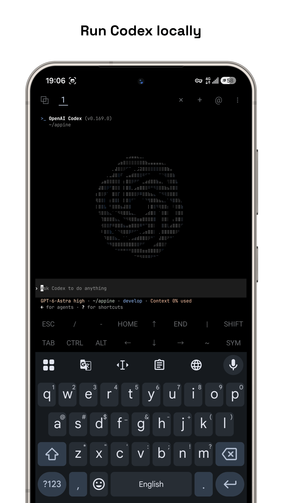
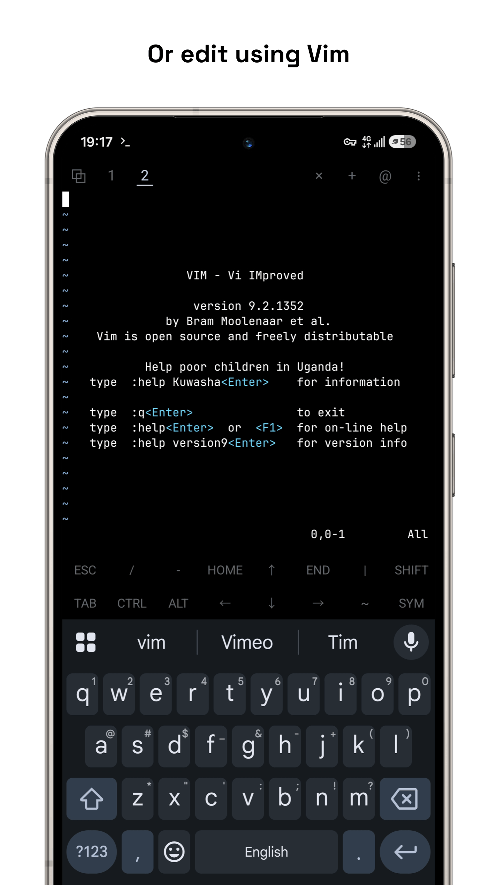
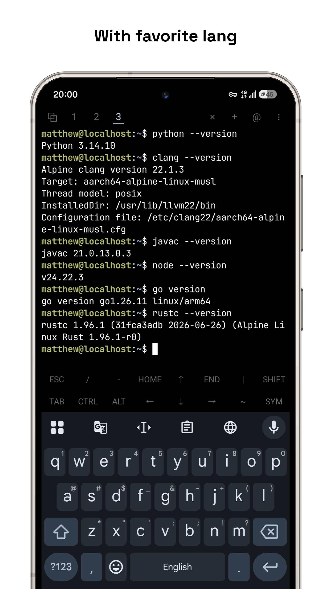
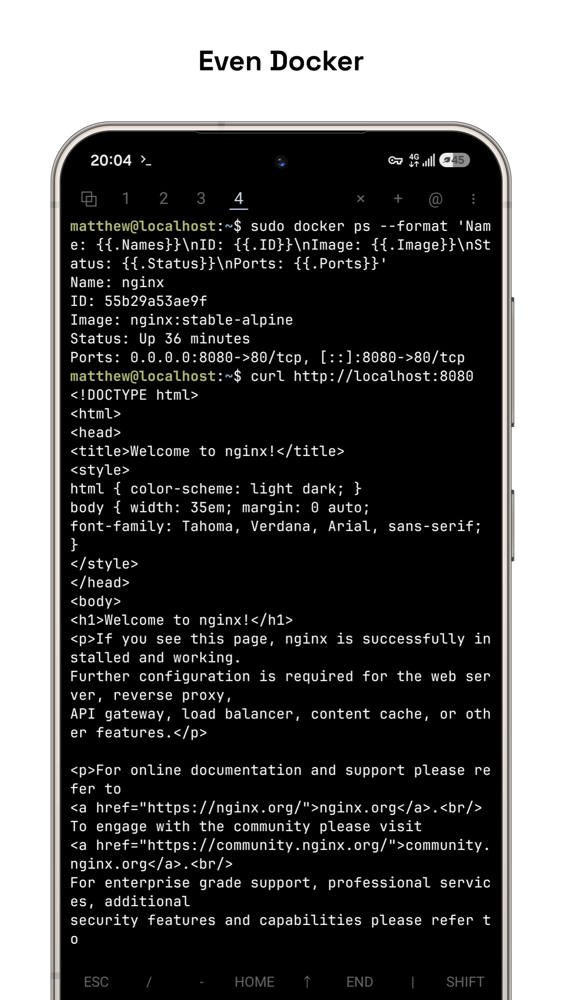
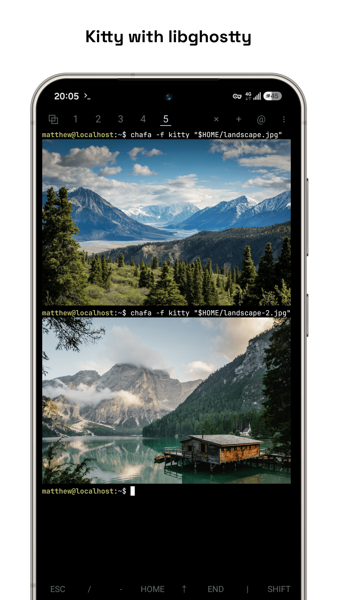

#  Tuxport

Tuxport is a high-performance Linux terminal for Android.

Install packages, edit code, and build projects on your phone or tablet without rooting it.

Alpine Linux comes bundled with the app. Debian is available from **Settings**.

**[Download Tuxport from GitHub Releases](https://github.com/sajadxdp0/tuxport/releases)** · **[Source](https://github.com/sajadxdp0/tuxport)**

Requires Android 11 or later on a 64-bit ARM device.

> **About this fork:** Tuxport is a rebranded, Neon Terminal-themed fork of
> [Appine](https://github.com/mthli/appine) by Matthew Lee. The original AGPL-3.0
> copyright, license and third-party notices are preserved.

## Features

<!-- The 128px dividers give all five columns the same minimum width on narrow screens. -->
<table>
  <tr>
    <td width="20%" align="center" valign="top">
      <a href="docs/screenshots/codex-cli.png"></a>
      <hr width="128">
      <p>Use <strong>Codex CLI</strong> to work on a local project from your Android terminal.</p>
    </td>
    <td width="20%" align="center" valign="top">
      <a href="docs/screenshots/vim.png"></a>
      <hr width="128">
      <p>Edit code and configuration files in <strong>Vim</strong>.</p>
    </td>
    <td width="20%" align="center" valign="top">
      <a href="docs/screenshots/languages.png"></a>
      <hr width="128">
      <p>Run Python scripts, compile C and C++, or develop with Java, Node.js, Go, and Rust.</p>
    </td>
    <td width="20%" align="center" valign="top">
      <a href="docs/screenshots/docker.png"></a>
      <hr width="128">
      <p>Run <strong>Docker</strong> containers on your device, for example to host an Nginx web server.</p>
    </td>
    <td width="20%" align="center" valign="top">
      <a href="docs/screenshots/kitty-graphics.png"></a>
      <hr width="128">
      <p>View images in terminal programs that use the <strong>Kitty graphics protocol</strong>.</p>
    </td>
  </tr>
</table>

## Try Codex CLI

### Alpine Linux (default)

```sh
apk update
apk add nodejs npm
npm install -g @openai/codex
```

### Debian

```sh
apt update
apt install nodejs npm
npm install -g @openai/codex
```

## How it works

Tuxport runs unmodified ARM64 Linux binaries inside the Android app process.
Its CPU engine translates ARM64 instructions into ARM64 code and uses an
interpreter for instructions it does not translate. A user-space kernel handles
Linux system calls, and the Android terminal uses Ghostty's libghostty-vt.
The Linux command-line runner uses the same engine and kernel.

## Development

### Build the Android app

Install JDK 17 or later, Android SDK Platform 37, NDK 29.0.14206865, Rust
with rustup, and Zig 0.17.0.

From the repository root, fetch the build inputs and install a debug build on a
connected ARM64 device or emulator.

```sh
rustup target add aarch64-linux-android
cargo install cargo-ndk --locked
scripts/fetch-rootfs
scripts/fetch-ghostty
cd android
./gradlew installDebug
```

Run `./gradlew connectedDebugAndroidTest` from the same directory for the
instrumentation tests. See the [Android build guide](android/README.md#building)
for Android Studio setup, release builds, and device tests.

### Develop and test the runtime

The primary development host is ARM64 Linux. On macOS, start a Docker-compatible
runtime such as Colima, OrbStack, or Docker Desktop. From the repository root,
`scripts/dev` runs each command in the project's ARM64 Linux container.

```sh
scripts/fetch-rootfs
scripts/dev cargo test --workspace
```

The workspace tests cover the kernel, guest programs, and CPU instruction execution.

#### Run a guest program or an Alpine shell

Build and run the assembly example in `tests/guest/hello.S`.

```sh
scripts/dev sh -c 'cc -nostdlib -static -no-pie -o /tmp/hello tests/guest/hello.S &&
                   cargo run -q -p tuxport-run -- --tier 1 /tmp/hello'
```

The C guest programs in `tests/guest` use `musl-gcc` from the `musl-tools` package.
The `scripts/dev` container includes it. If the compiler is missing, the test
suite skips the tests that need it.

To run BusyBox, import the Alpine minirootfs tarball. Without the tarball,
`cargo test` skips the rootfs tests.

```sh
scripts/fetch-rootfs # downloads and verifies target/rootfs/alpine-minirootfs-*.tar.gz
scripts/dev sh -c 'cargo build -q -p tuxport-run && run=target/linux-arm64/debug/tuxport-run &&
                   $run --rootfs target/store --import target/rootfs/alpine-minirootfs-*.tar.gz &&
                   $run --rootfs target/store /bin/busybox ls -l / &&
                   $run --rootfs target/store --env PATH=/bin:/usr/bin /bin/sh -c "ls / | wc -l"'
```

When stdin and stdout are connected to a terminal, `tuxport-run` gives the guest
an in-process terminal. The interactive login shell below supports job control
(`Ctrl-C`, `Ctrl-Z`, and `fg`) and full-screen programs such as `vi` and `top`.

```sh
scripts/dev target/linux-arm64/debug/tuxport-run --rootfs target/store \
    --env TERM=xterm-256color --env HOME=/root /bin/sh -l
```

The guest uses the host's network, so `apk` and `git` work. The guest only sees the
environment variables passed with `--env`. If the host needs a proxy, pass its
settings to the guest.

```sh
scripts/dev sh -c 'target/linux-arm64/debug/tuxport-run --rootfs target/store \
    --env PATH=/usr/sbin:/usr/bin:/sbin:/bin --env HOME=/root \
    --env http_proxy=$http_proxy --env https_proxy=$https_proxy \
    /bin/sh -c "apk update && apk add git python3"'
```

The tests that need the internet run only with `TUXPORT_NETWORK_TESTS=1`.

#### Run Linux Test Project syscall tests

Build the [Linux Test Project](https://github.com/linux-test-project/ltp) syscall
tests in an ARM64 Alpine container. The test runner starts a fresh `tuxport-run`
process for each test.

```sh
scripts/dev cargo build --release -p tuxport-run
scripts/build-ltp                        # builds target/ltp/ltp-<version>.tar (needs Docker)
scripts/dev scripts/ltp -j 8             # all syscall tests; results in target/ltp/results.txt
scripts/dev scripts/ltp 'fcntl.*|mmap.*' # only the tests whose name matches
```

#### Compare Tuxport with native Linux

`scripts/difftest` runs each script in `tests/diff` in both Tuxport and a native
ARM64 Docker container, then compares the output and exit status. The container
runs without Docker's seccomp profile because the profile changes what some
syscalls return, including `clone3` and `pidfd_getfd`.

Run these commands on the host. On macOS, `scripts/difftest` calls `scripts/dev`
itself.

```sh
scripts/fetch-rootfs
scripts/dev cargo build --release -p tuxport-run
scripts/difftest              # all cases on tier 1
scripts/difftest -t 0 signals # one case on the interpreter
```

The first run needs internet access. It creates a store in `target/difftest/store`
from the minirootfs and installs Python 3, GCC, Lua, SQLite, Go, Node.js,
OpenJDK 21, strace, and GDB with `apk`. It exports the root filesystem from
Tuxport and imports it as a Docker image so both sides use the same files.

If an older store lacks a package, install it in the store with `apk add` or
delete the store to rebuild it. In either case, pass `-r` to `scripts/difftest`
to export the filesystem again.

#### Benchmark, trace, and profile the runtime

For a longer lockstep comparison, run `tuxport-lockstep`. To compare
the interpreter and binary translator against native execution, run `tuxport-bench`.

```sh
scripts/dev cargo run --release -p tuxport-lockstep -- --iterations 1000000
scripts/dev sh -c 'cargo build --release -p tuxport-run -p tuxport-bench &&
                   target/linux-arm64/release/tuxport-bench'
```

To debug a failing test, rerun it with `TUXPORT_STRACE=1`. `tuxport-run` prints each syscall
with its arguments and result, so you can check which calls failed or returned unexpected
values.

To profile the runtime, run `tuxport-run` under `perf record` with `TUXPORT_PERF_MAP=1`.
Tier 1 writes `/tmp/perf-<pid>.map` so `perf report` can attribute samples in
translated code to guest addresses (`g_<pc>`).

Pass `--stats` to see how many blocks the translator compiled and why translated
code exited. `tier 0 fallback` counts instructions the translator leaves to the interpreter.
The `interp` count on the `exits` line records each runtime exit to the interpreter,
including exits caused by failed grouped memory checks.

#### Runtime failures and memory limits

In release builds, if the kernel or engine panics or the engine faults on host
memory, Tuxport kills only the affected guest process and reports the bug on
stderr. A panic in a `Machine` method called by the host fails only that call.

Debug builds abort `tuxport-run` so you can inspect the bug where it happened.
Set `TUXPORT_ON_BUG=kill` or `TUXPORT_ON_BUG=abort` to override the default.

If Tuxport's anonymous memory exceeds `--memory-limit` (half the RAM by default),
Tuxport sends `SIGKILL` to the guest process using the most memory, like the Linux
OOM killer.

## Project documentation

- [Architecture overview](docs/design/README.md#3-overall-architecture) and
  [module index](.agents/MODULES.md) for navigating the source.
- [Module maps](.agents/maps) for current behavior and tests, and
  [design decisions](.agents/decisions) for the reasoning behind changes.
- [Development milestones](docs/milestones.md) for earlier measurements and implementation history.
- Coding agents should start with [AGENTS.md](AGENTS.md).

## License

Copyright (C) 2026 Matthew Lee.
Tuxport rebrand and theme Copyright (C) 2026 Sajad.

Tuxport is licensed under the [GNU Affero General Public License, version 3 or later](LICENSE).

Parts of the terminal line discipline in `core/kernel/src/tty.rs` are adapted
from Fuchsia's Starnix and retain [The Fuchsia Authors' BSD-style license](android/licenses/fuchsia-LICENSE).

The app includes separate notices for libghostty-vt and its dependencies,
JetBrains Mono, Alpine Linux packages, Android libraries, and Rust crates.
Read them in **Settings → Open source licenses** or browse the
[bundled notices](android/app/src/main/assets/notices).
