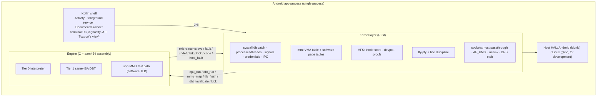

# Tuxport design

- **Status**: the design decisions were confirmed one by one in the design review of 2026-10-24. M0–M8 are done; M9 (release) is in progress, with real-device validation, the license obligations and the Play submission still to go (§14.1).
- **Scope**: v1. Sections 1–13 describe how things work now and are updated with each round's changes; how a change came about, its measurements and its sources are recorded in the rounds (written in Chinese, indexed in [milestones.md](../milestones.md)). Subsystems are moving section by section to their module's map under `.agents/maps/` (modules are listed in [MODULES.md](../../.agents/MODULES.md)); a migrated section is removed from here and the section numbers stay.
- **In one sentence**: a **single-process** Android app that can ship on Google Play and runs unmodified Alpine Linux aarch64 user-space programs in its own process, with an interpreter and a same-ISA binary translator. Same idea as iSH; its Android counterpart.

## Contents

1. [Goals and non-goals](#1-goals-and-non-goals)
2. [Hard constraints](#2-hard-constraints)
3. [Overall architecture](#3-overall-architecture)
4. CPU engine, moved to the [engine map](../../.agents/maps/engine.md)
5. Memory: a lightweight user-space soft-MMU, moved to the [kernel/mm map](../../.agents/maps/kernel/mm.md)
6. Processes, threads and scheduling, moved to the [kernel/process](../../.agents/maps/kernel/process.md), [kernel/time](../../.agents/maps/kernel/time.md) and [kernel/boot](../../.agents/maps/kernel/boot.md) maps
7. Signals and ABI, moved to the [kernel/signal map](../../.agents/maps/kernel/signal.md), [kernel/ptrace map](../../.agents/maps/kernel/ptrace.md) and [kernel/vdso map](../../.agents/maps/kernel/vdso.md)
8. File system, moved to the [kernel/store](../../.agents/maps/kernel/store.md), [kernel/vfs](../../.agents/maps/kernel/vfs.md), [kernel/procfs](../../.agents/maps/kernel/procfs.md) and [kernel/cgroup](../../.agents/maps/kernel/cgroup.md) maps
9. TTY and terminal, moved to the [kernel/tty map](../../.agents/maps/kernel/tty.md); the terminal UI is in the [android/terminal](../../.agents/maps/android/terminal.md), [android/vt](../../.agents/maps/android/vt.md), [android/vtcore](../../.agents/maps/android/vtcore.md), [android/vtview](../../.agents/maps/android/vtview.md), [android/vtrender](../../.agents/maps/android/vtrender.md), [android/tabbar](../../.agents/maps/android/tabbar.md), [android/keys](../../.agents/maps/android/keys.md) and [android/file-import](../../.agents/maps/android/file-import.md) maps
10. Networking, moved to the [kernel/net](../../.agents/maps/kernel/net.md), [kernel/netlink](../../.agents/maps/kernel/netlink.md), [kernel/netns](../../.agents/maps/kernel/netns.md), [kernel/nft](../../.agents/maps/kernel/nft.md), [kernel/unix](../../.agents/maps/kernel/unix.md) and [kernel/poll](../../.agents/maps/kernel/poll.md) maps
11. Users, permissions and Android integration, moved to the [kernel/cred](../../.agents/maps/kernel/cred.md), [android/service](../../.agents/maps/android/service.md), [android/setup](../../.agents/maps/android/setup.md), [android/documents](../../.agents/maps/android/documents.md), [android/terminal](../../.agents/maps/android/terminal.md), [android/privacy](../../.agents/maps/android/privacy.md), [android/licenses](../../.agents/maps/android/licenses.md), [android/native](../../.agents/maps/android/native.md), [android/build](../../.agents/maps/android/build.md) and [android/tests](../../.agents/maps/android/tests.md) maps
12. [Threat model](12-threat-model.md)
13. [Engineering](13-engineering.md)
14. [Milestones](14-milestones.md)
15. [Rejected approaches](15-rejected.md)
16. [Risks and assumptions to validate](16-risks.md)

---

## 1. Goals and non-goals

### 1.1 Goals

- A user installs the app from Play, opens it and gets an Alpine shell: no root, no Termux, no extra steps.
- The whole Linux environment runs inside the app's own process, so Android 12+'s phantom process killer does not apply to it.
- **Unmodified** binaries from Alpine's official aarch64 repositories run directly.

### 1.2 v1 workload classes

| Class | Workloads | v1 requirement |
|---|---|---|
| A everyday CLI | busybox ash, `apk`, coreutils, vim, git, curl, openssh client | **all usable** |
| B compute-heavy | python3, gcc/make building medium-sized C projects, `./configure` | **runs to completion** |
| C difficult runtimes | static Go binaries, node/V8, JVM | **correct behavior, speed not required** |
| D not promised | containers, init systems, kernel modules, X11/GUI | — |

Classes A–C are all met. In class D, podman and docker (namespaces in the [kernel/process map](../../.agents/maps/kernel/process.md), the [kernel/netns map](../../.agents/maps/kernel/netns.md)) and OpenRC (PID 1 in the [kernel/boot map](../../.agents/maps/kernel/boot.md)) actually work; systemd, kernel modules and GUI are out of scope. strace and gdb work ([kernel/ptrace map](../../.agents/maps/kernel/ptrace.md)).

The default distribution is Alpine; settings can switch it to Debian 13 ([android/setup map](../../.agents/maps/android/setup.md)). glibc programs (manylinux wheels, Node.js prebuilt modules, rustup, OpenJDK) run without changes to the kernel layer.

### 1.3 Performance goals

- CPU-bound tasks within **3–5×** of native (JIT class). Current status: R1 in §16.
- Interactive latency comes first: `ls` and tab completion must not feel sluggish.

## 2. Hard constraints

| Constraint | Source | Consequence |
|---|---|---|
| **Google Play compliance** | Device and Network Abuse policy: an app may not download executable code (dex/JAR/.so), except "code that runs in a virtual machine or an interpreter" | Alpine binaries downloaded from the network **cannot execute directly on the host CPU**; the CPU back end can only be an interpreter or a translator |
| Single process | Design goal + phantom process killer | All guest processes share one host address space; isolation between guest processes and fork must be implemented in software |
| W^X execution restriction | With targetSdk ≥ 29, files in the app's data directory cannot be `execve`d | No execve, and no reliance on the host loader |
| Storage restrictions | SELinux: the app cannot create hard links, `chown` or `mknod`; shared storage is case-insensitive, has no permission bits and cannot hold symlinks | File system metadata and the namespace must be implemented by Tuxport itself |
| Network restrictions | With targetSdk ≥ 30 the app cannot bind `NETLINK_ROUTE`, and `RTM_GETLINK` is blocked too; no `CAP_NET_RAW` | netlink is emulated in-process; ICMP goes through ping sockets |
| Page size | From Android 15, apps must be compatible with 16 KB page kernels | The page size presented to the guest must be decoupled from the host page size |
| Host address space | The common GKI configuration is 4K pages + 39-bit VA, giving user space only about 512 GB | A large contiguous address range cannot be reserved for each guest process |

The minimum system version is **minSdk 30 (Android 11)**: the Files app provider adds close callbacks to the fds it hands out with `ParcelFileDescriptor.wrap`, and the service tells why the previous run ended from `ApplicationExitInfo`, both available from API 30 (`android_res_nsend`, which the DNS stub relies on, from API 29).

## 3. Overall architecture

Layering principles:

- The **engine** only cares about executing guest instructions. On `svc`, a memory-access fault, an undefined instruction, `brk` or `ic ivau`, it hands control to the kernel layer.
- The **kernel layer** implements the Linux user-space ABI and holds all guest state: processes, address spaces, fds, file systems.
- The **host HAL** isolates host differences. The development host is Linux arm64 and the production host is Android; no other host builds (on macOS, development runs in a Linux container through `scripts/dev`).
- The core libraries (engine + kernel layer) **depend on no Android component**. Android-specific code appears only in the HAL and the Kotlin shell.

---

## References

- [Google Play: Device and Network Abuse policy](https://support.google.com/googleplay/android-developer/answer/9888379)
- [arm64: entry: Convert to Generic Entry v11 (2026-01, includes SUD)](https://lkml.iu.edu/2601.3/04930.html)
- [arm64 memory layout: 4KB pages + VA39 (LKML)](https://lore.kernel.org/lkml/YV3ZfmSHHKSWfDQu@arm.com/t/)
- [AOSP sepolicy: support hard linking for split APKs (removes link from create_file_perms)](https://android.googlesource.com/platform/external/sepolicy/+/9bef250)
- [Ghostty (libghostty-vt)](https://github.com/ghostty-org/ghostty)
- [azahar-emu/dynarmic (0BSD)](https://github.com/azahar-emu/dynarmic)
- iSH: <https://github.com/ish-app/ish> (GPLv3; only the ideas are borrowed, no code is copied)
